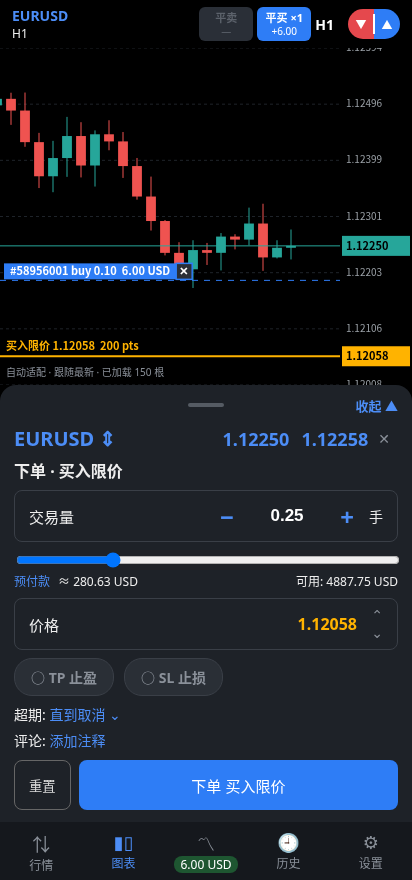
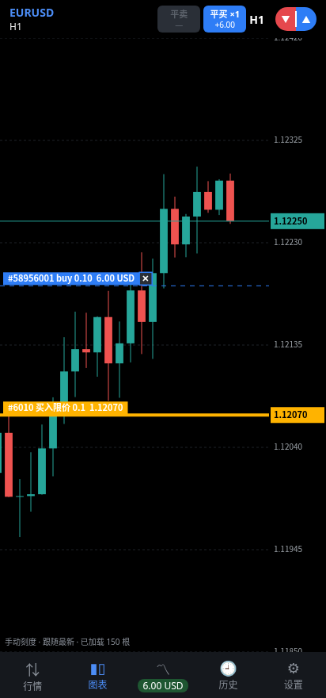
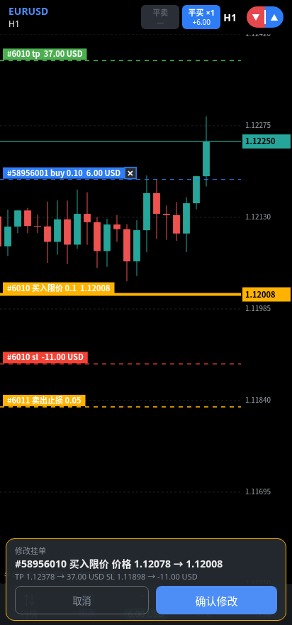

# MT5 Android Trader (MT TP/SL)

**English** | [简体中文](README.zh-CN.md)

**💬 Telegram group:** https://t.me/metatrader5pro_chat_group

MT5 Pro is a free, open-source project I build and maintain in my spare time. Server testing, new features and ongoing updates take real time and cost. If it saves you time or makes your trading smoother, consider buying me a coffee. Your support keeps the project going.

**☕ Donate (BSC / BEP20, Ethereum / ERC20, Base):** `0xB5f7e22fa69b5D88eeCc238A767b582d18CFF2bF`

An Android app (Kotlin + Jetpack Compose) that replicates the look and feel of the MetaTrader 5 mobile app, plus two features the official mobile app does not offer:

- **Draggable TP/SL lines** – on the chart you can drag take-profit / stop-loss lines up and down (for open positions, for pending orders and for new orders) and release to apply the change.
- **Market-price pre-order ("市价预备单")** – a TP/SL pair is pulled out of the *current market price*; drag the TP (required) and SL (optional) lines to where you want them, then send a market BUY/SELL order with the TP/SL attached.

The app does not talk to MetaTrader directly. It talks to a small **Python FastAPI bridge** that runs on a Windows machine next to your MT5 terminal and uses the official [`MetaTrader5`](https://pypi.org/project/MetaTrader5/) Python package.

> **Note:** the UI strings of the app and the server console messages are currently in Chinese. A built-in demo mode (simulated data, no server needed) lets you try the app without any account.

> ⚠️ Trading is risky. Read the [Security](#security) and [Risk disclaimer](#risk-disclaimer) sections before connecting a real account. Use a **demo account** first.

## What's new (v0.13 – v0.15)

- **v0.15**: **partial close** (choose the volume to close; the server `/close` accepts a `volume` parameter); **live USD / points labels** on the SL/TP lines while dragging; **MT5-style buttons** – inactive SL/TP buttons are shown gray; one **shared pinned HTTP client with retries** for better connection stability; server `/health` reports its `version`, symbol info includes **tick value / tick size**, and `--setup` installs a **watchdog scheduled task** that restarts the bridge.
- **v0.14**: **trust-on-first-use certificate pinning** – setup needs only the server address and the API key; the connection code is accepted **with or without the `MT5PRO1:` prefix**; input fields **never auto-clear**; TP/SL lines of open positions are **draggable** with a confirm bar.
- **v0.13**: **HTTPS only** – no cleartext connections; one-step `--setup` on the server.

See [CHANGELOG.md](CHANGELOG.md) for details.

## Screenshots

The images below are screenshots of the browser demo in [`demo/index.html`](demo/index.html) (simulated data, a web re-implementation of the UI), not of the Android app itself.

| Market-price pre-order panel | Dragging a pending-order line | Confirm bar after dragging |
|---|---|---|
|  |  |  |

## Features

App (`app/`):

- Bottom navigation: **Quotes / Chart / Trade / History / Settings**.
- Custom-drawn candlestick chart (Compose Canvas), timeframes M1–D1, price axis, pan and zoom; shows open positions and pending orders as lines.
- **Draggable TP/SL lines** on open positions (validated against the symbol's minimum stop distance before sending).
- **Market-price pre-order**: pull TP/SL from the market price, drag, confirm, send a market order with TP/SL.
- Order types: market buy/sell, Buy/Sell Limit, Buy/Sell Stop, Buy/Sell Stop Limit; expiration GTC / Day / Specified.
- Drag the entry / trigger / stop-limit / TP / SL lines of **existing pending orders** on the chart; after release a confirm bar ("old price → new price") appears and the order is only modified after you confirm.
- Close a position from the chart (confirm dialog); "close all" of the current symbol and side (confirm dialog can be turned off in Settings). Note that the server closes the **whole** position (see [Known limitations](#known-limitations)).
- Trade tab: balance, equity, margin, free margin, margin level; position and pending-order lists (modify / close / delete).
- History tab: deals and P/L for today / 7 / 30 / 90 days.
- Live prices over WebSocket, with connection diagnostics (explains common errors such as a bad URL, cleartext blocked, wrong API key, timeout, TLS fingerprint mismatch / untrusted certificate) and a "test connection" button.
- **HTTPS only** (v0.13+): `http://` / `ws://` addresses are rejected ("必须使用 HTTPS 地址") and the app never connects in cleartext. One-step setup: run `--setup` on the server, paste the **connection code** into the app (see [HTTPS](#https-one-step-setup-with-a-connection-code)). From v0.14 the app **remembers a self-signed certificate automatically** on the first successful connection test (trust on first use) and pins it from then on – customers only type the server address and the API key.
- Crash log kept in the app's private storage (viewable/clearable in Settings); API keys / passwords / tokens are redacted from it.
- **Demo mode** (default): in-memory simulated market and order matching, no account or server required.
- Unit tests for the pure logic (`app/src/test`).

Server (`server/main.py`, FastAPI):

- API-key authentication via the `X-API-Key` header (constant-time comparison); WebSocket also accepts `?key=`.
- Quotes, candles, symbol info, account info, positions, pending orders, margin estimate, deal history.
- Market order with TP/SL attached, modify position TP/SL (server-side re-validation), close position, place / modify / delete pending orders.
- Server-time → UTC conversion (automatic, or fixed with `MT5_SERVER_UTC_OFFSET_HOURS`).
- One-step HTTPS setup: `mt5-bridge.exe --setup <ip>` (or `server/setup.bat` / `setup.py`) generates a strong API key and a self-signed certificate, writes `.env` and prints a **connection code** (plus a console QR code). Also available separately: `--make-cert <ip>` / `server/make-cert.py`.
- Failed order requests are **not** retried automatically (to avoid duplicate fills).

## Architecture


The MetaTrader5 Python package only works on Windows with a running, logged-in MT5 terminal on the same machine.

## Requirements

**Server (Windows)**

- Windows 10/11 or Windows Server (64-bit) with the MetaTrader 5 terminal installed, logged in, and "Algo Trading" enabled (green button) – otherwise orders are rejected.
- Python 3.11 / 3.12 (64-bit) – or use the PyInstaller build, which needs no Python on the target machine.
- Python packages: see [`server/requirements.txt`](server/requirements.txt) (`MetaTrader5`, `fastapi`, `uvicorn[standard]`, `python-dotenv`, `cryptography` – the last one only for generating certificates).

**Android app**

- Android 8.0+ (`minSdk 26`, `targetSdk 34`).
- To build: JDK 17, Android SDK platform 34, Gradle 8.9 (the included Gradle wrapper downloads it), Android Gradle Plugin 8.5.2, Kotlin 2.0.20.

## Running the server

Full (Chinese) instructions: [`server/README.md`](server/README.md). Summary:

```bat
cd server
python -m venv .venv
.venv\Scripts\pip install -r requirements.txt
copy .env.example .env
:: edit .env (see below), then:
run.bat
```

Open `http://127.0.0.1:8000/health` and `http://127.0.0.1:8000/docs` to check it is running. To run it at logon, use Windows Task Scheduler ("run only when user is logged on", because the MT5 terminal is a desktop program) – see `server/README.md`.

### Configuration (`server/.env`)

| Key | Meaning |
|---|---|
| `BRIDGE_API_KEY` | **Required.** Long random string the app must send in `X-API-Key`. Generate one: `python -c "import secrets;print(secrets.token_urlsafe(32))"` |
| `MT5_LOGIN` | Optional. MT5 account number. If empty, the server uses the account already logged in in the terminal. |
| `MT5_PASSWORD` | Optional. Password for `MT5_LOGIN`. |
| `MT5_SERVER` | Trade server name used with `MT5_LOGIN` (default `MetaQuotes-Demo`). |
| `MT5_PATH` | Optional. Full path to `terminal64.exe` if you have several terminals. |
| `HOST` | Listen address (default `127.0.0.1`; `--host` on the command line overrides it). |
| `PORT` | Listen port (default `8000`). |
| `SSL_CERTFILE` / `SSL_KEYFILE` | Optional. PEM certificate and private key; set **both** to serve HTTPS, leave empty for plain HTTP. See [HTTPS](#https-self-signed-certificate-on-a-bare-ip-or-a-real-certificate). |
| `DEVIATION` | Max price deviation (points) for market orders (default `20`). |
| `MAGIC` | Magic number put on orders (default `20261019`). |
| `MT5_SERVER_UTC_OFFSET_HOURS` | Broker server time offset from UTC in hours. Empty = auto-detect. |

The `.env` file is read from the folder of `main.py` (or next to the `.exe` for the PyInstaller build).

### Endpoints

All endpoints except `/health` require the `X-API-Key` header.

| Method | Path | Description |
|---|---|---|
| GET | `/health` | Health check (no auth) |
| GET | `/account` | Account info |
| GET | `/symbol/{symbol}` | digits / point / stops level / volume limits |
| GET | `/candles?symbol=EURUSD&timeframe=1m&count=200[&start=N]` | Candles; timeframes `M1 M5 M15 M30 H1 H4 D1` (also `1m`…`1d`); `start` skips N bars back to load older history |
| GET | `/positions` | Open positions |
| POST | `/order` | Market order `{symbol, side: BUY/SELL, volume, sl, tp, comment}` (TP/SL sent with the order) |
| POST | `/positions/{ticket}/modify` | `{tp, sl}` (0 = remove), server re-validates |
| POST | `/positions/{ticket}/close` | Close the whole position |
| GET | `/quotes?symbols=EURUSD,GBPUSD` | Quote list (bid/ask/spread/daily change %) |
| GET | `/orders` | Pending orders |
| GET | `/margin?symbol=EURUSD&side=BUY&volume=0.01` | Estimated margin + free margin |
| POST | `/pending` | Place pending order (`BUY_LIMIT`, `SELL_LIMIT`, `BUY_STOP`, `SELL_STOP`, `BUY_STOP_LIMIT`, `SELL_STOP_LIMIT`; expiration `GTC`/`DAY`/`SPECIFIED`) |
| POST | `/orders/{ticket}/modify` | Modify pending order (price, stoplimit, sl, tp, expiration) |
| DELETE | `/orders/{ticket}` | Delete pending order |
| GET | `/history?days=7` | Deal history (UTC times) |
| WS | `/ws/ticks?symbol=EURUSD` | Live ticks (server polls `symbol_info_tick` every 200 ms) |

### Building the Windows executable (PyInstaller folder build)

The folder build (`mt5-bridge.exe` + `_internal/`) starts faster than a one-file build and needs no Python on the target machine. Build it on Windows:

```bat
cd server
python -m venv .venv
.venv\Scripts\pip install -r requirements.txt pyinstaller
.venv\Scripts\pyinstaller --noconfirm mt5-bridge.spec
```

Result: `server\dist\mt5-bridge\` containing `mt5-bridge.exe` and the `_internal` folder. **Keep both together** – the exe does not work alone. Copy `.env.example` into that folder, rename it to `.env`, fill it in, and double-click `mt5-bridge.exe` (or run it with `--host 0.0.0.0 --port 8000`). The spec has `upx=True`; if UPX is not installed PyInstaller simply skips it. PyInstaller executables are sometimes flagged by antivirus / SmartScreen (false positives); build it yourself if you do not trust a binary.

## HTTPS (one-step setup with a connection code)

Since v0.13 the app **only talks HTTPS** – there is no cleartext fallback. Every customer runs **their own** bridge server and sets up **their own** API key; nobody has to handle certificates or fingerprints by hand. Three steps:

1. **On the server** (the Windows machine with the MT5 terminal), next to `.env` / `mt5-bridge.exe`:
   ```bat
   mt5-bridge.exe --setup 203.0.113.10
   :: from source:  python main.py --setup 203.0.113.10   (or double-click setup.bat)
   ```
   `203.0.113.10` is a documentation-only address – use your server's own public IP. In one go this: generates a random strong `BRIDGE_API_KEY` if `.env` has none (an existing key is kept), creates a 10-year self-signed certificate for that IP if `cert.pem` / `key.pem` are missing (existing ones are kept; `--force` regenerates), writes/updates `.env` (`BRIDGE_API_KEY`, `SSL_CERTFILE`, `SSL_KEYFILE`, `HOST=0.0.0.0`, `PORT`; other lines are preserved), and prints a single **connection code** plus a console QR code (`--no-qr` to skip). The private key is never printed. It is safe to run again – it prints the same code. The code is also printed at every normal start while TLS is on.
2. **Open the port** (TCP, default 8000) in Windows Firewall *and* in your cloud provider's security group, then start the bridge.
3. **In the app**: Settings → type the server address and the API key → 保存 → 测试连接. That is enough: on the first successful test the app records the server certificate's SHA-256 and pins it (v0.14+). Optional shortcut: **导入连接码** (under **高级**) → paste → the code fills URL, key and fingerprint at once; the pasted text stays in the box.

The connection code is `MT5PRO1:` + base64url of the JSON `{"u": "https://<ip>:<port>", "k": "<api key>", "f": "<SHA-256 fingerprint>"}`. **It contains the API key – treat it like a password** (only send it to your own phone; do not post it publicly or in screenshots).

Manual setup still works: type the `https://` address and the API key, and put the fingerprint (only needed for a self-signed certificate) under the collapsible **高级** section. The **生成密钥** button fills a random 256-bit API key – you must then also put the same value into the server's `.env` (`BRIDGE_API_KEY=`). With a real certificate (e.g. Let's Encrypt via `SSL_CERTFILE` / `SSL_KEYFILE`, or a reverse proxy such as Caddy) leave the fingerprint empty.

How the app handles TLS:

- `https://` **with** a fingerprint: only a server certificate whose leaf SHA-256 equals the fingerprint is accepted (certificate pinning, REST and WebSocket). Nothing else is trusted – not even CA-signed certificates – and host-name verification is relaxed **only** in this pinned mode (the pin identifies the exact certificate). Expired certificates are still rejected.
- `https://` **without** a fingerprint: normal system trust store and host-name verification. If the server presents a self-signed / untrusted certificate, the first successful **测试连接** (and first real connect) with a **valid API key** records that certificate's SHA-256 into the saved config (shown under **高级**) and pins it from then on (trust on first use). The certificate is read with a handshake only; the API key is sent only over the already pinned connection. A malformed or different saved fingerprint is never replaced.
- If a pinned certificate later changes, the app refuses with "服务器证书与已记录的不一致" and offers a **重置证书记录** button (Settings, 高级 and the connection banner); after a reset the next successful connection records the certificate again. Only reset if you regenerated the server certificate yourself.
- No input box in Settings is ever cleared automatically (import success, errors, saving, tab switches, rotation); errors stay visible until you edit.
- `http://` and `ws://`: **rejected** with "必须使用 HTTPS 地址" – in Settings (save is refused), in the test button, in the connection code import and when the client is created. If you omit the scheme the app assumes `https://`; a `wss://` address is treated as `https://`. OkHttp itself is also configured without the cleartext connection spec, does not follow https→http redirects, and the manifest sets `usesCleartextTraffic="false"`. Demo mode (no server) is unaffected.
- Certificate verification is never switched off. The connection diagnosis explains fingerprint mismatch, untrusted / expired certificates, host-name mismatch and handshake failures (in Chinese).

**Upgrading from v0.12 or earlier:** a saved `http://` server address stops working (the app shows the error and stays in demo mode) – run `--setup` on the server and import the connection code.

### For distributors

Each customer needs their own server and their own `--setup` run; there are no build-time defaults and no server address or key is ever compiled into the APK. Never commit a real IP, API key, connection code, `.env`, `*.pem` or fingerprint to a repository or put them in a README / `gradle.properties`.

## Building and installing the Android app

### Build from source

Requirements: JDK 17, Android SDK 34 (set `sdk.dir` in `local.properties`, or `ANDROID_HOME`).

```bash
# local.properties (not committed):  sdk.dir=/path/to/Android/sdk
./gradlew assembleRelease        # -> app/build/outputs/apk/release/app-release.apk
./gradlew assembleDebug          # debug build
./gradlew testDebugUnitTest      # unit tests
```

On Windows use `gradlew.bat`. The release build type is signed with the **debug** signing config (see `app/build.gradle.kts`), so no keystore is needed – but such an APK is not suitable for Google Play. If you want your own release key, change the `signingConfig` yourself and never commit the keystore.

### Install a prebuilt APK

Download `mt-tpsl-v15.apk` (version 0.15) from the GitHub **Releases** page of this repository and install it on your phone. The APK is signed with a debug key, not a Play Store key; you must allow **installing from unknown sources** for your browser / file manager. You may need to uninstall an older build that was signed with a different key first. As with any APK from the internet, only install it if you trust the source – or build it yourself.

### Configure the app

Open **Settings** (设置):

1. Turn **demo mode** off (it is on by default).
2. Easiest: just the server address and the API key – the certificate is remembered automatically on the first successful test connection (v0.14+). Optional: **导入连接码** under **高级** – run `mt5-bridge.exe --setup <your-server-ip>` on the server, copy the connection code it prints, paste it in the app.
3. Or manually: **Server URL** `https://<server-ip>:8000` (an IP or domain plus port; HTTPS only, `http://` is refused; if you omit the scheme the app assumes `https://`), and the **API key** (the value of `BRIDGE_API_KEY` on the server; "生成密钥" creates a random one that you must also put into the server's `.env`).
4. **高级** (collapsed): the recorded **HTTPS certificate fingerprint (SHA-256)** (optional; filled in automatically, can be reset), and the optional connection-code import.
5. Save, then use the connection test button.

The app stores the server URL and API key in its private preferences (Jetpack DataStore). It never stores your MT5 login or password – those only live in the server's `.env`.

## Security

- **HTTPS only (v0.13+).** The app refuses `http://` / `ws://` addresses and the Android manifest sets `usesCleartextTraffic="false"`; the bridge itself still speaks plain HTTP until TLS is enabled (run `--setup`), so do not expose the port before that. A plain-HTTP bridge is simply unreachable from the app.
- Chart: the TP / SL lines of open positions and the lines of pending orders can be dragged up/down (24dp touch tolerance, vertical drags do not pan the chart); after release a confirm bar "修改持仓 … 旧价 → 新价" appears and nothing is sent until you confirm (v0.14 fixed position TP/SL lines that could not be dragged).
- **The connection code contains the API key.** Treat it like a password: only copy it to your own phone, never post it publicly. Anyone who has it can control the connected account.
- **Self-signed certificates:** trust on first use means the certificate seen on the first successful connection is trusted from then on, so do the first test on a network you trust (or paste the fingerprint / connection code from the server console yourself, which pins it up front). `key.pem` is a private key – never share or commit it.
- Alternatively put a reverse proxy with HTTPS in front (e.g. Caddy: `caddy reverse-proxy --from your.domain.com --to 127.0.0.1:8000`) and keep the bridge on `127.0.0.1`. Alternatively reach the server through a VPN / overlay network such as Tailscale or ZeroTier.
- **Restrict access by IP:** use the Windows firewall and your cloud provider's security group to allow only your own IPs.
- Use a long random `BRIDGE_API_KEY`. Anyone with the key and network access can place and close trades on the connected account.
- **Never commit `.env`** (it is git-ignored; only `.env.example` belongs in the repo) and never share it. Never put the API key or MT5 credentials in the APK or in source code.
- **Use a demo account first** and test every flow before connecting a live account.

## Risk disclaimer

Trading foreign exchange, CFDs and other leveraged products involves a high level of risk and can result in the loss of more than your initial deposit. This software is **not financial advice**, is experimental, and may contain bugs that cause unintended orders or losses. You are solely responsible for any trades placed with it. It is provided **"as is"**, without warranty of any kind (see [LICENSE](LICENSE)).

This project is an independent work and is **not affiliated with, endorsed by or sponsored by MetaQuotes Ltd.** MetaTrader and MT5 are trademarks of MetaQuotes Ltd. No MetaQuotes assets are used; the UI is drawn from scratch to resemble MT5.

## Known limitations

- **No partial close** on the server: `/positions/{ticket}/close` always closes the full volume, so the app closes full positions only.
- Only MT5 is implemented (there is an `MT4` enum value in the config, but no MT4 bridge).
- Tested only on a limited set of devices / emulators and against a MetaQuotes-Demo account (server verified on Linux + Wine + Windows Python 3.11, per `server/README.md`); it has not been tested on all Android versions, screen sizes or brokers. Symbols with unusual trading rules may behave differently.
- The bridge serves a single MT5 terminal/account and has no user management; the API key is the only protection. The MetaTrader5 Python package is not thread-safe, so calls are serialized with a lock.
- The server must run in an interactive Windows session (the MT5 terminal is a desktop application); running it as a Windows service in Session 0 may fail.
- UI texts are Chinese only (no localization yet).
- The prebuilt release APK uses a debug signing key.

## Project layout

```
app/        Android app (Kotlin, Jetpack Compose) and unit tests
server/     FastAPI bridge (main.py), certgen.py (+ miniqr.py QR) / setup.py / setup.bat (one-step setup), make-cert.py (self-signed certificate), test_setup.py, .env.example, run.bat, mt5-bridge.spec (PyInstaller)
demo/       Browser demo of the UI (index.html) and screenshots
docs/       Historical development notes (Chinese)
```

## License

[MIT](LICENSE) © 2026 Morris Wing
