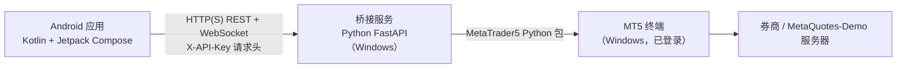

# MT5 Android Trader（MT TP/SL）

[English](README.md) | **简体中文**

一个用 Kotlin + Jetpack Compose 编写的 Android 应用，复刻 MetaTrader 5 手机端的界面与操作，并加入官方手机端没有的两个功能：

- **可拖动的 TP/SL 线**：在图表上上下拖动止盈 / 止损线（适用于已有持仓、已有挂单和新订单），松手后应用修改。
- **市价预备单（market-price pre-order）**：从**当前市价**位置拉出 TP/SL 线，拖动 TP（必填）和 SL（可选）到想要的位置，再发送带 TP/SL 的市价买入 / 卖出单。

App 并不直接连接 MetaTrader，而是连接一个运行在 Windows 上、与 MT5 终端同机的小型 **Python FastAPI 桥接服务**，该服务通过官方 [`MetaTrader5`](https://pypi.org/project/MetaTrader5/) Python 包与终端通信。

> **说明：**App 界面文字和服务端控制台提示目前为中文。App 内置**演示模式**（模拟数据，无需服务器和账户），可直接体验。

> ⚠️ 交易有风险。连接真实账户前请阅读下面的[安全](#安全)与[风险声明](#风险声明)，并**先使用模拟账户**。

## 截图

下列图片来自浏览器演示页 [`demo/index.html`](demo/index.html)（模拟数据，是界面的网页版复现），不是 Android 应用本身的截图。

| 市价预备单面板 | 拖动挂单线 | 拖动后的确认条 |
|---|---|---|
|  |  |  |

## 功能

App（`app/`）：

- 底部导航：**报价 / 图表 / 交易 / 历史 / 设置**。
- 自绘 K 线图（Compose Canvas），周期 M1–D1，价格刻度，平移与缩放；持仓和挂单以线的形式显示在图上。
- 已有持仓的 **TP/SL 线可拖动**（发送前按品种最小止损距离校验）。
- **市价预备单**：从市价拉出 TP/SL → 拖动 → 确认 → 发送带 TP/SL 的市价单。
- 订单类型：市价买入/卖出、Buy/Sell Limit、Buy/Sell Stop、Buy/Sell Stop Limit；有效期 GTC / 当日 / 指定时间。
- **已有挂单**的开仓/触发价线、Stop Limit 限价线、TP/SL 线都可在图上拖动；松手后出现“旧价 → 新价”确认条，确认后才会修改订单。
- 在图表上平仓（有确认对话框）；对当前品种、指定方向“一键全部平仓”（确认对话框可在设置中关闭）。注意：服务端只能整仓平仓（见[已知限制](#已知限制)）。
- 交易页：余额、净值、预付款、可用预付款、预付款比例；持仓与挂单列表（修改 / 平仓 / 删除）。
- 历史页：今天 / 7 天 / 30 天 / 90 天的成交与盈亏。
- 通过 WebSocket 获取实时报价；带连接诊断（能解释 URL 格式错误、明文 HTTP 被拦截、API Key 错误、超时、TLS 指纹不匹配 / 证书不受信任等常见问题）和“测试连接”按钮。
- **HTTPS**：支持对自签名证书做 SHA-256 指纹固定（见 [HTTPS](#https裸-ip-自签名证书或正规证书)）。
- 崩溃日志保存在 App 私有目录（可在设置中查看 / 清除），其中的 API Key / 密码 / token 会被抹掉。
- **演示模式**（默认）：内存中的模拟行情与撮合，无需账户和服务器。
- 针对纯逻辑的单元测试（`app/src/test`）。

服务端（`server/main.py`，FastAPI）：

- 通过 `X-API-Key` 请求头认证（常量时间比较）；WebSocket 也接受 `?key=` 参数。
- 报价、K 线、品种信息、账户信息、持仓、挂单、预付款估算、历史成交。
- 带 TP/SL 的市价单、修改持仓 TP/SL（服务端二次校验）、平仓、挂单的创建 / 修改 / 删除。
- 服务器时间 → UTC 换算（自动测算，或用 `MT5_SERVER_UTC_OFFSET_HOURS` 固定）。
- 可选 TLS（`SSL_CERTFILE` / `SSL_KEYFILE`）和自签名证书生成器（`mt5-bridge.exe --make-cert <ip>` / `server/make-cert.py`）。
- 下单失败**不会**自动重发（避免重复成交）。

## 架构



MetaTrader5 Python 包只能在 Windows 上使用，且同一台机器上必须运行着已登录的 MT5 终端。

## 环境要求

**服务端（Windows）**

- Windows 10/11 或 Windows Server（64 位），已安装 MetaTrader 5 终端、已登录，并开启“算法交易 / Algo Trading”（按钮为绿色），否则下单会被拒绝。
- Python 3.11 / 3.12（64 位）；或使用 PyInstaller 打包版（目标机器无需 Python）。
- Python 依赖见 [`server/requirements.txt`](server/requirements.txt)（`MetaTrader5`、`fastapi`、`uvicorn[standard]`、`python-dotenv`、`cryptography`（仅生成证书时用到））。

**Android 应用**

- Android 8.0+（`minSdk 26`，`targetSdk 34`）。
- 自行编译需要：JDK 17、Android SDK 平台 34、Gradle 8.9（随附的 Gradle Wrapper 会自动下载）、Android Gradle 插件 8.5.2、Kotlin 2.0.20。

## 运行服务端

完整说明见 [`server/README.md`](server/README.md)。摘要：

```bat
cd server
python -m venv .venv
.venv\Scripts\pip install -r requirements.txt
copy .env.example .env
:: 按下表编辑 .env，然后：
run.bat
```

浏览器打开 `http://127.0.0.1:8000/health` 和 `http://127.0.0.1:8000/docs` 确认服务已运行。如需开机自启，请用 Windows 任务计划程序（“只在用户登录时运行”，因为 MT5 终端是桌面程序），详见 `server/README.md`。

### 配置（`server/.env`）

| 变量 | 含义 |
|---|---|
| `BRIDGE_API_KEY` | **必填。**App 必须在 `X-API-Key` 头中携带的长随机串。生成：`python -c "import secrets;print(secrets.token_urlsafe(32))"` |
| `MT5_LOGIN` | 可选。MT5 账号；留空则使用终端中已登录的账户。 |
| `MT5_PASSWORD` | 可选。`MT5_LOGIN` 对应的密码。 |
| `MT5_SERVER` | 与 `MT5_LOGIN` 搭配使用的交易服务器名（默认 `MetaQuotes-Demo`）。 |
| `MT5_PATH` | 可选。有多个终端时，指定 `terminal64.exe` 的完整路径。 |
| `HOST` | 监听地址（默认 `127.0.0.1`；命令行 `--host` 优先）。 |
| `PORT` | 监听端口（默认 `8000`）。 |
| `SSL_CERTFILE` / `SSL_KEYFILE` | 可选。PEM 证书和私钥；**两项都填**才启用 HTTPS，都留空则为纯 HTTP。见 [HTTPS](#https裸-ip-自签名证书或正规证书)。 |
| `DEVIATION` | 市价单允许的最大价格偏差（点，默认 `20`）。 |
| `MAGIC` | 订单的 Magic Number（默认 `20261019`）。 |
| `MT5_SERVER_UTC_OFFSET_HOURS` | 券商服务器时间相对 UTC 的小时数；留空 = 自动测算。 |

`.env` 从 `main.py` 所在目录读取（PyInstaller 版则从 exe 同目录读取）。

### 接口

除 `/health` 外都需要 `X-API-Key` 请求头。

| 方法 | 路径 | 说明 |
|---|---|---|
| GET | `/health` | 健康检查（无需认证） |
| GET | `/account` | 账户信息 |
| GET | `/symbol/{symbol}` | digits / point / 最小止损距离 / 手数限制 |
| GET | `/candles?symbol=EURUSD&timeframe=1m&count=200[&start=N]` | K 线；周期 `M1 M5 M15 M30 H1 H4 D1`（也可写 `1m`…`1d`）；`start` 为往回跳过的 K 线数，用于加载更早历史 |
| GET | `/positions` | 持仓 |
| POST | `/order` | 市价单 `{symbol, side: BUY/SELL, volume, sl, tp, comment}`（TP/SL 随单发送） |
| POST | `/positions/{ticket}/modify` | `{tp, sl}`（0 = 删除），服务端二次校验 |
| POST | `/positions/{ticket}/close` | 整仓平仓 |
| GET | `/quotes?symbols=EURUSD,GBPUSD` | 报价列表（bid/ask/点差/日涨跌%） |
| GET | `/orders` | 挂单列表 |
| GET | `/margin?symbol=EURUSD&side=BUY&volume=0.01` | 预估预付款 + 可用预付款 |
| POST | `/pending` | 创建挂单（`BUY_LIMIT`、`SELL_LIMIT`、`BUY_STOP`、`SELL_STOP`、`BUY_STOP_LIMIT`、`SELL_STOP_LIMIT`；有效期 `GTC`/`DAY`/`SPECIFIED`） |
| POST | `/orders/{ticket}/modify` | 修改挂单（price、stoplimit、sl、tp、有效期） |
| DELETE | `/orders/{ticket}` | 删除挂单 |
| GET | `/history?days=7` | 历史成交（UTC 时间） |
| WS | `/ws/ticks?symbol=EURUSD` | 实时报价（服务端每 200 ms 轮询 `symbol_info_tick`） |

### 构建 Windows 可执行文件（PyInstaller 文件夹版）

文件夹版（`mt5-bridge.exe` + `_internal/`）比单文件版启动更快，目标机器无需安装 Python。请在 Windows 上构建：

```bat
cd server
python -m venv .venv
.venv\Scripts\pip install -r requirements.txt pyinstaller
.venv\Scripts\pyinstaller --noconfirm mt5-bridge.spec
```

产物：`server\dist\mt5-bridge\`，其中有 `mt5-bridge.exe` 和 `_internal` 文件夹。**两者必须放在一起**，exe 不能单独使用。把 `.env.example` 复制到该文件夹并改名为 `.env`、填写后，双击 `mt5-bridge.exe`（或加参数 `--host 0.0.0.0 --port 8000`）运行。spec 中 `upx=True`；若未安装 UPX，PyInstaller 会直接跳过。PyInstaller 程序有时会被杀毒软件 / SmartScreen 误报；如果不信任别人提供的二进制文件，请自行构建。

## HTTPS（裸 IP 自签名证书，或正规证书）

桥接服务自带 TLS。在 `server/.env` 里**同时**设置 `SSL_CERTFILE` 和 `SSL_KEYFILE`（相对路径按 `.env` 所在目录解析）即可；两项都留空则与以前完全一样，仍是纯 HTTP。

1. **为你的服务器 IP 生成自签名证书**（有效期 10 年，IP 写入 `subjectAltName`；需要 `cryptography` 包，已在 `requirements.txt` 中，打包的 exe 已内置）：
   ```bat
   mt5-bridge.exe --make-cert 203.0.113.10
   :: 从源码运行时：
   python make-cert.py 203.0.113.10
   ```
   `203.0.113.10` 是仅用于文档的示例地址，请换成你服务器自己的 IP。命令会写出 `cert.pem` 和 `key.pem`（**`key.pem` 是私钥，不要外传**；`*.pem` 已被 git 忽略），并打印证书的 **SHA-256 指纹**（`AA:BB:…`，共 32 组）。已有文件不会被覆盖，需要重新生成请加 `--force`（之后 App 里的指纹也要更新）。
2. **在 `.env` 中启用**，然后重启桥接服务（控制台会显示 `https://…` 和指纹）：
   ```
   HOST=0.0.0.0
   SSL_CERTFILE=cert.pem
   SSL_KEYFILE=key.pem
   ```
3. **放行端口**：Windows 防火墙和云厂商安全组都要放行（如腾讯云：安全组 → 入站规则 → TCP + 你的端口），来源最好限制为你自己的 IP。
4. **在 App 中**（v0.12 及以上）：服务器地址填 `https://<服务器IP>:8000`，把指纹粘贴到 **HTTPS 证书指纹 (SHA-256)**，点“测试连接”。

App 对 TLS 的处理：

- `https://` **且填了指纹**：只接受叶子证书 SHA-256 与指纹完全一致的服务器证书（证书固定，REST 与 WebSocket 都适用）。其他证书一律不信任（包括 CA 签发的），主机名校验**仅在此固定模式下**放宽（指纹已唯一确定证书）。已过期的证书仍会被拒绝。
- `https://` **没填指纹**：使用系统信任库和标准主机名校验（用正规证书，如 Let's Encrypt：把 `SSL_CERTFILE` / `SSL_KEYFILE` 指向 fullchain / privkey 即可）。
- `http://`：行为不变。`ws://` / `wss://` 由 http / https 推导。
- 任何情况下都不会关闭证书校验。连接诊断会用中文解释指纹不匹配、证书不受信任 / 已过期、主机名不匹配和握手失败。

启用 TLS 后该端口只接受 https：旧版 App（≤ v0.11）和 `http://` 地址将无法连接。

## 构建与安装 Android 应用

### 从源码构建

需要：JDK 17、Android SDK 34（在 `local.properties` 中设置 `sdk.dir`，或设置 `ANDROID_HOME`）。

```bash
# local.properties（不要提交）：  sdk.dir=/path/to/Android/sdk
./gradlew assembleRelease        # -> app/build/outputs/apk/release/app-release.apk
./gradlew assembleDebug          # 调试版
./gradlew testDebugUnitTest      # 单元测试
```

Windows 下使用 `gradlew.bat`。release 构建使用 **debug** 签名配置（见 `app/build.gradle.kts`），因此不需要自备密钥库，但这样的 APK 不能上架 Google Play。如需自己的发布密钥，请自行修改 `signingConfig`，并且不要提交密钥库文件。

### 安装预编译 APK

从本仓库 GitHub **Releases** 页面下载 `mt-tpsl-v12.apk`（版本 0.12）并安装到手机。该 APK 使用 debug 密钥签名（不是应用商店密钥），需要允许浏览器 / 文件管理器**安装未知来源应用**。如果手机上有用不同密钥签名的旧版本，可能需要先卸载。和任何来自网络的 APK 一样，请只在信任来源时安装，或自行编译。

### 在 App 中配置

打开**设置**：

1. 关闭**演示模式**（默认开启）。
2. **服务器地址**：如 `http://203.0.113.10:8000`（IP 或域名 + 端口；`203.0.113.10` 是仅用于文档的示例地址，请换成你自己的）。桥接服务启用 HTTPS 后填 `https://<服务器IP>:8000`；使用反向代理 / 正规证书则填 `https://your.domain.com`。不写协议时 App 会自动补 `http://`。
3. **HTTPS 证书指纹 (SHA-256)**：仅自签名证书需要——粘贴 `--make-cert` 打印的指纹；正规 CA 证书和 `http://` 请留空。
4. **API Key**：填服务端 `BRIDGE_API_KEY` 的值。
5. 保存，然后点“测试连接”。

App 把服务器地址和 API Key 保存在应用私有存储（Jetpack DataStore）中；不会保存你的 MT5 账号和密码——它们只存在于服务端的 `.env` 里。

## 安全

- **默认是明文 HTTP。**除非启用 TLS（见 [HTTPS](#https裸-ip-自签名证书或正规证书)），服务端使用 HTTP，Android 清单中设置了 `usesCleartextTraffic="true"`，因此 API Key 和所有交易流量都是**未加密**传输。不要把端口以明文 HTTP 直接暴露到公网；请启用带证书固定的 HTTPS。
- **自签名证书：**粘贴到 App 的指纹必须来自可信渠道（服务器控制台 / 你自己保存的输出）。`key.pem` 是私钥，不要分享或提交。
- 也可以在前面加一层 HTTPS 反向代理（如 Caddy：`caddy reverse-proxy --from your.domain.com --to 127.0.0.1:8000`），桥接服务保持监听 `127.0.0.1`；或通过 Tailscale / ZeroTier 等 VPN / 组网工具访问。
- **用 IP 白名单限制来源：**在 Windows 防火墙和云厂商安全组中只放行你自己的 IP。
- `BRIDGE_API_KEY` 使用足够长的随机串。任何拿到密钥且能访问该服务的人都能在所连账户上开仓和平仓。
- **绝不要提交 `.env`**（已加入 `.gitignore`，仓库中只应有 `.env.example`），也不要发给任何人。不要把 API Key 或 MT5 凭据写进 APK 或源码。
- **先用模拟账户**，把所有流程测试清楚后再考虑实盘。

## 风险声明

外汇、差价合约等杠杆产品的交易风险很高，可能损失超过初始资金。本软件**不构成投资建议**，属于实验性质，可能存在导致意外下单或亏损的缺陷。使用本软件下的任何交易均由你自行负责。软件按“**原样**”提供，不附带任何形式的担保（见 [LICENSE](LICENSE)）。

本项目为独立作品，**与 MetaQuotes Ltd. 无任何关联，也未获其认可或赞助**。MetaTrader 和 MT5 是 MetaQuotes Ltd. 的商标。项目未使用任何 MetaQuotes 素材，界面为自行绘制、仅在外观上类似 MT5。

## 已知限制

- 服务端**不支持部分平仓**：`/positions/{ticket}/close` 总是平掉全部手数，所以 App 只能整仓平仓。
- 目前只实现了 MT5（配置中虽有 `MT4` 枚举值，但没有 MT4 桥接）。
- 仅在有限的设备 / 模拟器上、针对 MetaQuotes-Demo 账户测试过（服务端按 `server/README.md` 在 Linux + Wine + Windows 版 Python 3.11 上验证）；未在所有 Android 版本、屏幕尺寸和券商上测试。交易规则特殊的品种可能表现不同。
- 桥接服务只对应一个 MT5 终端 / 账户，没有用户管理，API Key 是唯一的保护。MetaTrader5 Python 包不是线程安全的，因此调用通过锁串行化。
- 服务必须运行在交互式 Windows 会话中（MT5 终端是桌面程序）；作为 Session 0 的 Windows 服务运行可能失败。
- 界面文字仅有中文（暂无多语言）。
- 预编译 release APK 使用 debug 签名密钥。

## 项目结构

```
app/        Android 应用（Kotlin、Jetpack Compose）及单元测试
server/     FastAPI 桥接服务（main.py）、certgen.py + make-cert.py（自签名证书）、.env.example、run.bat、mt5-bridge.spec（PyInstaller）
demo/       界面的浏览器演示（index.html）及截图
docs/       历史开发笔记（中文）
```

## 许可证

[MIT](LICENSE) © 2026 Morris Wing
